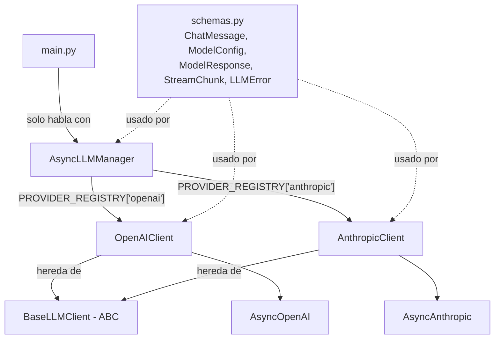

# Unified Async LLM Client

Cliente **asíncrono** y **unificado** para OpenAI y Anthropic, escrito en Python 3.12+.
Trabajo práctico de la Pre-entrega 1 del curso de AI Engineering.

## ¿Qué hace?

- Expone **una sola interfaz** (`AsyncLLMManager`) para hablar con OpenAI o Anthropic. Para cambiar de proveedor alcanza con cambiar un string.
- Todas las llamadas son **no bloqueantes** (`async`/`await`) y usan los clientes oficiales `AsyncOpenAI` y `AsyncAnthropic`.
- Soporta **streaming** con generadores asíncronos (`async for` + `yield`).
- Valida mensajes y configuración con **Pydantic v2** antes de llamar a la API.
- **Nunca rompe el programa** por un error de la API: los errores se devuelven como datos (`LLMError`).

## Estructura

```
unified-llm-client/
├── .env.example          # Plantilla de configuración
├── requirements.txt      # Dependencias
├── main.py               # Demo: normal, streaming, validación y resiliencia
└── llm_client/
    ├── __init__.py       # API pública del paquete
    ├── schemas.py        # Modelos Pydantic (contrato de datos)
    ├── base.py           # Clase abstracta BaseLLMClient
    ├── openai_client.py  # Implementación para OpenAI
    ├── anthropic_client.py # Implementación para Anthropic
    └── manager.py        # AsyncLLMManager (factory + fachada)
```

## Cómo se relacionan las piezas



Flujo de una llamada: `main.py` arma una lista de `ChatMessage` → `AsyncLLMManager.generate()` delega en el cliente del proveedor → el cliente traduce los mensajes al formato de su SDK, hace el `await` y devuelve un `ModelResponse` (o un `StreamChunk` por fragmento en modo streaming).

## Instalación

Requiere **Python 3.12 o superior**.

### Windows (PowerShell)

```powershell
py -3.12 -m venv .venv
.venv\Scripts\Activate.ps1
pip install -r requirements.txt
```

### Linux / macOS

```bash
python3.12 -m venv .venv
source .venv/bin/activate
pip install -r requirements.txt
```

## Configuración (`.env`)

Copiá la plantilla y completá tus valores:

```bash
cp .env.example .env
```

(En Windows: `copy .env.example .env`.) El archivo `.env` está en `.gitignore`, así que tus keys nunca se suben al repo.

| Variable | Qué significa | Default |
|---|---|---|
| `LLM_PROVIDER` | Proveedor que usa `AsyncLLMManager.from_env()` si no se indica otro (`openai` o `anthropic`). | `openai` |
| `OPENAI_API_KEY` | API key de OpenAI. Si está vacía, `main.py` omite OpenAI. | — |
| `ANTHROPIC_API_KEY` | API key de Anthropic. Si está vacía, `main.py` omite Anthropic. | — |
| `OPENAI_MODEL` | Modelo de OpenAI. | `gpt-6-luna` |
| `ANTHROPIC_MODEL` | Modelo de Anthropic. | `claude-haiku-5-5` |
| `LLM_TEMPERATURE` | Aleatoriedad (0 = determinista). OpenAI: 0–2. Anthropic: 0–1 (ver Decisiones de diseño). | `0.7` |
| `LLM_MAX_TOKENS` | Máximo de tokens generados. En Anthropic incluye los tokens de *thinking*. | `1024` |
| `LLM_MAX_RETRIES` | Reintentos automáticos del SDK ante errores transitorios. | `2` |
| `LLM_TIMEOUT` | (Opcional) segundos máximos por request. | default del SDK |
| `LOG_LEVEL` | (Opcional) nivel de logging: `INFO`, `WARNING`, `CRITICAL`... | `WARNING` |

Los modelos por defecto se verificaron en la documentación oficial (noviembre 2026):
[OpenAI Models](https://developers.openai.com/api/docs/models) y [Claude Models overview](https://platform.claude.com/docs/en/about-claude/models/overview). Se eligieron los modelos chicos y económicos de cada proveedor.

## Ejecución

```bash
python main.py
```

El script hace, en orden:

1. **Validación con Pydantic:** muestra cómo se rechaza una config de Anthropic con `temperature=1.5` y un mensaje vacío.
2. **Por cada proveedor con API key:** pregunta "¿Qué es la entropía?" en modo normal (imprime la respuesta y los tokens usados) y después en modo streaming (el texto aparece de a fragmentos).
3. **Prueba de resiliencia:** fuerza una API key inválida en ambos proveedores y muestra que el error se imprime de forma controlada y el programa sigue.

Salida esperada (resumida) con keys válidas:

```
======================================================================
Proveedor: openai | modelo: gpt-6-luna
======================================================================

--- [openai] Modo normal ---
La entropía es una medida del desorden de un sistema...

(tokens -> input: 28, output: 95)

--- [openai] Modo streaming ---
La entropía es una magnitud que mide...
```

Y en la prueba de resiliencia:

```
--- [anthropic] Modo normal ---
[ERROR] tipo=authentication retryable=False
        Error code: 401 - {... 'message': 'invalid x-api-key' ...}
...
El programa siguió funcionando a pesar de los errores.
```

Las líneas `ERROR llm_client...` que aparecen arriba vienen del módulo `logging` de la librería (van a `stderr`). Con `LOG_LEVEL=CRITICAL` se ocultan.

## Manejo de errores

Los clientes **nunca lanzan** excepciones de la API hacia afuera:

- `generate()` devuelve `ModelResponse(success=False, error=LLMError(...))`.
- `stream()` emite un último `StreamChunk(error=LLMError(...))` y termina. El `try/except` envuelve todo el `async for`, porque el error puede llegar a mitad del stream (por ejemplo, si se corta la red).

Cada excepción del SDK se traduce a un `LLMError` normalizado:

| Excepción del SDK | `type` | `retryable` | Por qué |
|---|---|---|---|
| `RateLimitError` (429) | `rate_limit` | ✅ | Superaste el límite por minuto; esperando funciona. |
| `AuthenticationError` (401) | `authentication` | ❌ | La key es inválida; reintentar da el mismo error. |
| `APITimeoutError` | `timeout` | ✅ | El servidor tardó; puede ser momentáneo. |
| `APIConnectionError` | `connection` | ✅ | Problema de red. |
| `APIStatusError` 5xx | `api_error` | ✅ | Falla del servidor (transitoria). |
| `APIStatusError` 4xx | `api_error` | ❌ | La request está mal (modelo inexistente, parámetro inválido). |
| Cualquier otra `Exception` | `unknown` | ❌ | No sabemos qué pasó; asumimos lo seguro. |

Además, el SDK ya reintenta solo los errores transitorios (`LLM_MAX_RETRIES` veces, con espera exponencial). Si llega un `LLMError` con `retryable=True`, significa que esos reintentos ya se agotaron.

Los errores de **configuración** (proveedor no soportado, API key faltante, valores fuera de rango en el `.env`) sí lanzan `ValueError`, pero al **construir** el manager, no en medio de una llamada. Así se detectan lo antes posible.

## Decisiones de diseño

### Dos métodos separados: `generate()` y `stream()`

Una función que contiene `yield` es **siempre** un generador: al llamarla no ejecuta nada, devuelve un objeto que hay que recorrer con `async for`. No puede "a veces devolver un valor y a veces streamear" según un flag `stream=True`. Separar los dos métodos deja claro qué devuelve cada uno (`ModelResponse` vs. `AsyncIterator[StreamChunk]`) y el type checker lo puede verificar.

### Validación de temperatura por proveedor

OpenAI acepta `temperature` entre 0 y 2; Anthropic, históricamente, entre 0 y 1. Como la regla depende de **dos campos** (`provider` y `temperature`), se implementa con un `model_validator(mode="after")` en `ModelConfig`, que corre después de validar cada campo por separado. Así una config incoherente falla localmente con un mensaje claro, antes de gastar una llamada a la API.

**Nota importante:** al verificar la documentación vigente se encontró que los modelos Claude 5.x **ya no aceptan** `temperature`, `top_p` ni `top_k` (la guía de migración indica omitirlos, y el SDK `anthropic` 2.x ya no los tiene como parámetros). Por eso `AnthropicClient` **no los envía**. La validación de `ModelConfig` se mantiene porque lo pide la consigna y porque mantiene la misma interfaz para ambos proveedores, pero en Anthropic el valor no tiene efecto. En su lugar, el cliente envía `output_config={"effort": "low"}` para que el modelo "piense" poco en preguntas simples (los tokens de *thinking* cuentan dentro de `max_tokens`).

### Registro de proveedores en el Manager (factory + fachada)

`AsyncLLMManager` elige la clase del cliente buscándola en un diccionario:

```python
PROVIDER_REGISTRY = {
    "openai": OpenAIClient,
    "anthropic": AnthropicClient,
}
```

en lugar de una cadena `if provider == "openai": ... elif ...`. Agregar un proveedor nuevo es implementar su clase (subclase de `BaseLLMClient`) y sumar **una línea** al registro. Esto es el patrón **factory**. Además, el Manager es una **fachada**: `main.py` solo conoce `generate()` y `stream()` y no sabe nada de los SDKs.

### Clase abstracta `BaseLLMClient`

Define el contrato que cumple todo cliente. Si una subclase olvida implementar `generate` o `stream`, Python lanza `TypeError` al instanciarla. Gracias a este contrato común, el Manager puede tratar a todos los clientes por igual.

### Mapeo de errores en una función por proveedor

En vez de repetir siete bloques `except` en `generate` y otros siete en `stream`, cada cliente tiene una función (`map_openai_error` / `map_anthropic_error`) que clasifica la excepción con `isinstance`, de la más específica a la más general (por ejemplo, `APITimeoutError` hereda de `APIConnectionError`, así que se chequea primero). Los métodos capturan `Exception` y delegan la clasificación en esa función.

### Diferencias entre SDKs (resueltas dentro de cada cliente)

| Aspecto | OpenAI | Anthropic |
|---|---|---|
| Mensajes `system` | Dentro de `messages` | Parámetro `system` aparte |
| `max_tokens` | Opcional (`max_completion_tokens`) | Obligatorio |
| Texto de la respuesta | `choices[0].message.content` (string) | Lista de bloques; se toman los de tipo `text` |
| Tokens usados | `prompt_tokens` / `completion_tokens` | `input_tokens` / `output_tokens` |
| Streaming | `create(stream=True)` + `chunk.choices[0].delta.content` | `async with messages.stream(...)` + `text_stream` |
| Sampling (`temperature`, `top_p`) | Se envían | No se envían (Claude 5.x no los acepta) |
